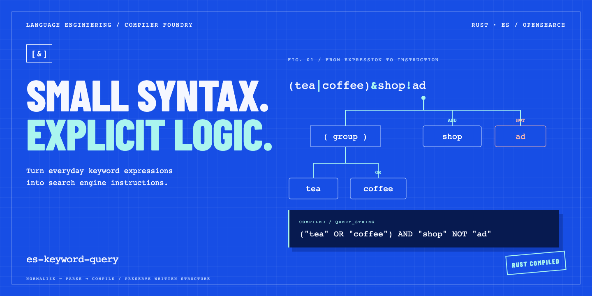
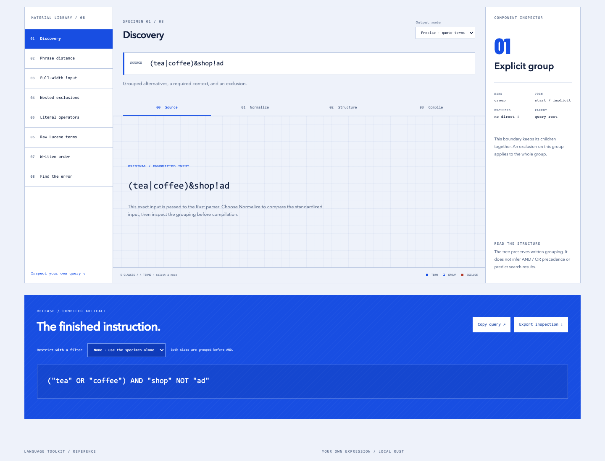
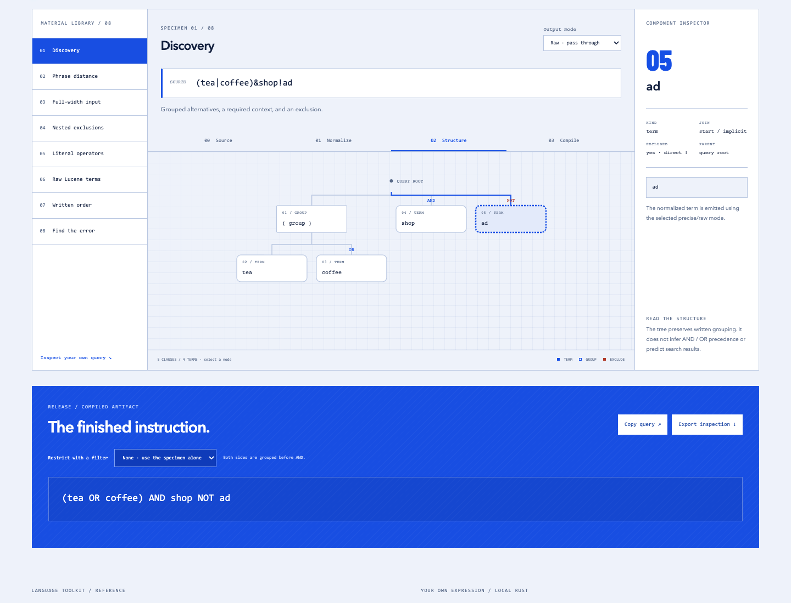
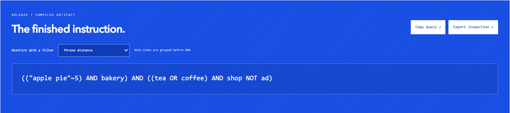
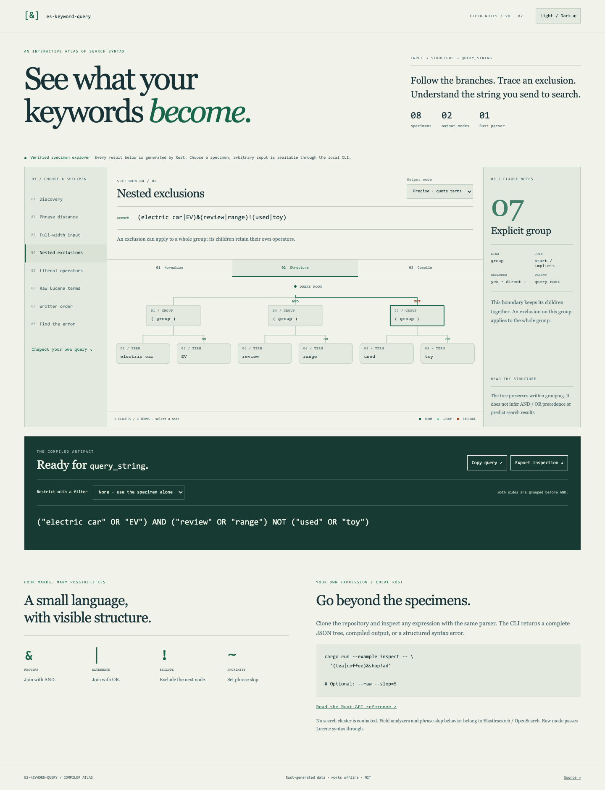
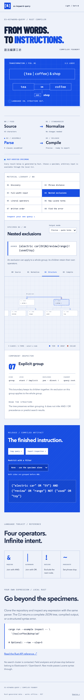

# es-keyword-query

A compact boolean keyword syntax that compiles to an Elasticsearch / OpenSearch
[`query_string`](https://www.elastic.co/guide/en/elasticsearch/reference/current/query-dsl-query-string-query.html).

It is meant for people who maintain long keyword lists (brand monitoring, media
tracking, content filters) and should not have to write Lucene by hand.

```
(apple|(apple pie ~))&store!rumor
```

becomes

```
("apple" OR ("apple pie"~20)) AND "store" NOT "rumor"
```

[Open the Compiler Foundry](docs/index.html) · [API docs: `cargo doc --open`](#development)

## A query through the foundry

Open [Compiler Foundry](docs/index.html) and follow the same `Discovery` specimen,
`(tea|coffee)&shop!ad`, through these three steps. These are real captures of the
checked-in Rust-generated atlas, not a live search cluster. The browser explores
eight finite examples; use the [CLI](#development) for arbitrary expressions.

**1. Choose the source.** Select **Discovery**, then **00 Source**. The source panel
shows the unchanged expression; the initial Precise mode quotes each term.



**2. Read the structure and change the output mode.** Open **02 Structure**, select
**ad** (click, or focus and press Enter), and choose **Raw · pass through**. The
inspector identifies a direct exclusion; ordinary terms now pass through unquoted.
The selected source remains unchanged.



**3. Compose and export.** Open **03 Compile**, choose **Phrase distance** under
**Restrict with a filter**, then **Export inspection**. Both expressions are grouped
before AND. The downloaded JSON's `query_string` matches the displayed output and
retains the Discovery source. This image is a crop of the actual release workbench.



[Reproduce these captures and inspect the checks](docs/workflow-verification.md).
The separate [editable cover](docs/images/src/cover.html) is repository artwork.

<details><summary>Full application gallery · light, dark and mobile</summary>





</details>

## Syntax

| Syntax | Meaning | Output |
|---|---|---|
| `a&b` | both | `"a" AND "b"` |
| `a\|b` | either | `"a" OR "b"` |
| `a!b` | the first without the second | `"a" NOT "b"` |
| `(a\|b)&c` | grouping | `("a" OR "b") AND "c"` |
| `(a b ~)` | the words within 20 positions of each other | `("a b"~20)` |
| `(a b ~5)` | the words within 5 positions | `("a b"~5)` |
| `\&` `\|` `\!` `\~` `\(` `\)` `\\` | the literal character | |

- Input is NFKC-normalised, so full-width `＆ ｜ ！ （ ）` work like their ASCII forms.
- Every term is quoted and matches as an exact phrase. Turn `precise` off to
  pass terms through unquoted, which lets wildcards (`iphone*`) and field names
  (`title:apple`) reach Lucene.
- Operators are written out in the order typed and no precedence is added.
  Use parentheses whenever `&` and `|` are mixed.

## Usage

```toml
[dependencies]
es-keyword-query = { git = "https://github.com/NatLee/es-keyword-query" }
```

```rust
use es_keyword_query::{Options, Query};

let query = Query::parse("(珍珠奶茶|(珍珠 鮮奶 ~))!廣告")?;
query.to_query_string(); // ("珍珠奶茶" OR ("珍珠 鮮奶"~20)) NOT "廣告"
query.terms();           // ["珍珠奶茶", "珍珠 鮮奶", "廣告"]

// Unquoted terms and a different default slop.
let options = Options { precise: false, default_slop: 10, ..Options::default() };
Query::parse_with("iphone*&(case|cover)", options)?.to_query_string();
// iphone* AND (case OR cover)
```

Put the result in a `query_string` query:

```json
{ "query": { "query_string": { "query": "<output>", "fields": ["title", "content"] } } }
```

## Composing filters

`filtered_by` groups **both** expressions before joining them with AND. This
keeps a filter containing OR from leaking into the main query:

```rust
use es_keyword_query::Query;
let search = Query::parse("tea|coffee")?;
let filter = Query::parse("shop|cafe")?;
assert_eq!(search.filtered_by(&filter),
    r#"("shop" OR "cafe") AND ("tea" OR "coffee")"#);
```

## Errors

`Query::parse` returns an `Error` with a `kind`, the character `position`, and a
message in English (`message()`, also `Display`) and Traditional Chinese
(`message_zh()`).

| Input | Kind |
|---|---|
| empty string, `()` | `Empty` |
| `a&&b`, `a&\|b` | `ConsecutiveOperators` |
| `&a`, `a\|`, `!a` | `DanglingOperator` |
| `((a)` | `UnbalancedParentheses` |
| `(a)b`, `a ~ b` | `MissingOperator` |
| `~a`, `(a\|b)~` | `BadProximity` |
| `*` | `LoneWildcard` |
| `a**` | `ConsecutiveWildcards` |
| a comma, when `Comma::Reject` is set | `Comma` |
| more than 128 nested groups | `NestingTooDeep` |

## Commas

By default a comma is part of the term. `Comma::Join(Joiner::Or)` splits the
input on top-level commas instead: `a,b|c` becomes `("a") OR ("b" OR "c")`.

## Development

The crate has one runtime dependency, `unicode-normalization`. It does not
connect to a search cluster or execute searches. Query behavior still depends
on the target engine's fields and analyzers; proximity slop is not a character
count. Raw mode intentionally passes Lucene syntax through and is not an
escaping boundary for untrusted input.

The [Compiler Foundry](docs/index.html) opens directly in a browser, works offline,
and explores **eight finite Rust-generated specimens**. Select a clause in the
branch diagram, follow source → normalization → structure → compilation, switch precise/raw
output, and compose a grouped filter. Copy the compiled query or export its JSON
inspection. It does not compile arbitrary input in the browser. The cobalt blueprint and black/cyan
drafting surfaces expose the production stages, active clause and exact release artifact.
Arrow keys, Home and End move between stage tabs. Barlow Condensed is bundled
locally with its [license and provenance](docs/fonts/README.md); no font CDN is required.

For arbitrary expressions, use the local CLI:

```sh
cargo run --example inspect -- '(tea|coffee)&shop!ad'
cargo run --example inspect -- '(apple pie ~)' --raw --slop=5
```

It prints JSON with `valid`, compiled output, normalized input and a flat clause
list, or a structured syntax error (exit status 1). Unknown options exit with 2.

The same inspection is available in Rust:

```rust
let query = es_keyword_query::Query::parse("(tea|coffee)&shop")?;
let clauses = query.clauses();
assert_eq!(clauses[1].parent, Some(0));
assert_eq!(clauses[2].joiner, Some(es_keyword_query::Joiner::Or));
```

`Clause` records parent indices, node kind, direct exclusion, joiner, normalized
term, resolved phrase slop and exact leaf output. It preserves written structure;
it does not infer Boolean precedence or predict engine results.

Regenerate the checked-in atlas data after parser changes:

```sh
cargo run --example build_atlas
cargo run --example build_atlas -- --check
```

The library retains one runtime dependency. `serde_json` is used only by development
examples. The README opens with a separate illustrated cover; the walkthrough and gallery are actual application captures. [Visual insights notes](docs/visual-insights.md)
cover the design, reading order, tests and browser verification.

```
cargo fmt --check
cargo clippy --all-targets -- -D warnings
cargo test
cargo doc --no-deps --open
```

[Design and audit notes](docs/design-and-audit.md) describe the layout, parser
fixes, and validation scope.

## License

[MIT](LICENSE) © 2022 Nat Lee
